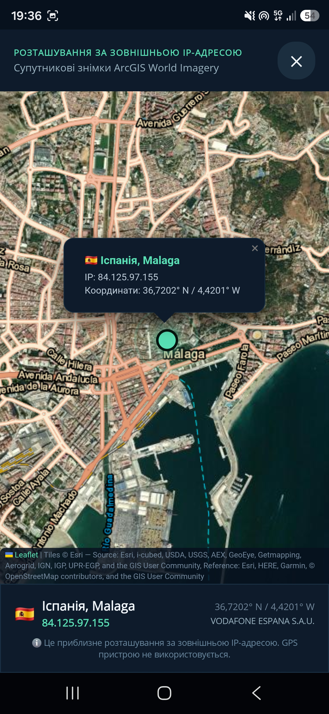
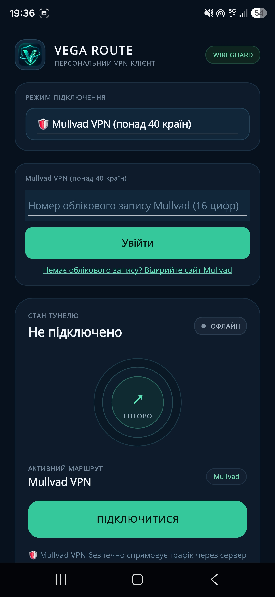
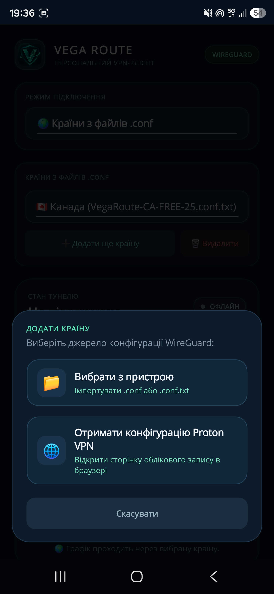
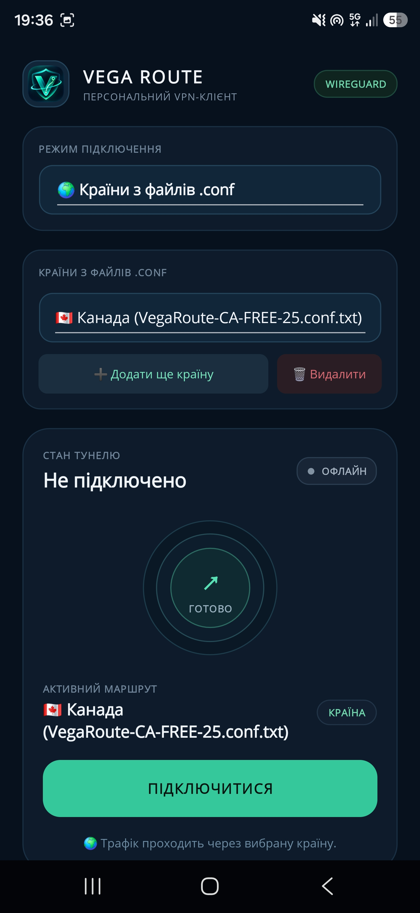

<strong>📸 VIEW SCREENSHOTS (6) — CLICK TO OPEN</strong>

<h3>🌐 Vega Route — Android Screenshots</h3>

<strong>🏠 Main Screen</strong>

<strong>🗺️ IP Geolocation Map</strong>

<strong>📡 Network Information</strong>

<strong>🛡️ Mullvad VPN</strong>

<strong>📂 WireGuard Configuration Import</strong>

<strong>🌍 Country Selection</strong>

# 🌐 Vega Route

### Secure VPN • Private Connection • Interactive Maps

**Vega Route** is a VPN and network location application for Android, combining encrypted internet connectivity, VPN server management, IP geolocation, and interactive maps in one interface.

Protect your connection, switch between available VPN locations, and explore your network's geographic location.

---

## ✨ Features

### 🔐 Secure VPN Connection

- Encrypted internet traffic through VPN tunnels.
- VPN connection and disconnection management.
- Real-time connection status monitoring.
- Secure VPN configuration management.

### 🌍 VPN Locations

- Switch between available VPN servers and countries.
- Manage VPN connection profiles.
- View the currently selected connection location.
- Verify your network location after connecting.

### 🗺️ Interactive Maps

- Interactive geographic map.
- Display your current network location.
- Explore geographic locations directly on the map.
- Visualize location information associated with your public IP address.

### 📡 IP & Network Information

- Public IP address detection.
- IP-based geographic location.
- Network location verification.
- VPN connection status and diagnostics.

### 🎨 User Interface

- Mobile-friendly Android interface.
- Convenient VPN connection controls.
- Integrated map navigation.
- Clear network and location information.

### 🌍 Automatic Language Detection & Localization

- Automatically detects the device's system language.
- Adapts the application interface to the detected language when a corresponding localization is available.
- Provides automatic fallback to the default language when necessary.
- No manual language configuration required.

---

## 📱 Platform

**Android**

## 🔒 Privacy & Security

Vega Route uses VPN connections to encrypt supported network traffic.

VPN server selection can change the public IP address and the geographic location associated with your internet connection.

**Note:** IP-based geolocation is approximate and does not necessarily represent the device's physical GPS location.

---

## 📦 Installation

1. Open the [Releases](https://github.com/Roman-git-hub/VegaRoute/releases) page.
2. Download the latest Android APK.
3. Install the APK on your Android device.
4. Launch Vega Route and configure your VPN connection.

## 🔄 Updates

Official application updates are distributed through GitHub Releases.

---

## 🛠️ Technology

- Android
- VPN tunneling
- IP geolocation services
- Interactive map integration

---

## 📄 License

Vega Route is distributed as freeware under a proprietary license.

You may download, install, and use official releases free of charge.

Copyright © 2026 Roman-git-hub. All rights reserved.

See [LICENSE](LICENSE) for full terms.

Third-party components remain subject to their respective licenses.

---

**Vega Route — Secure your connection. Explore your network location.**
