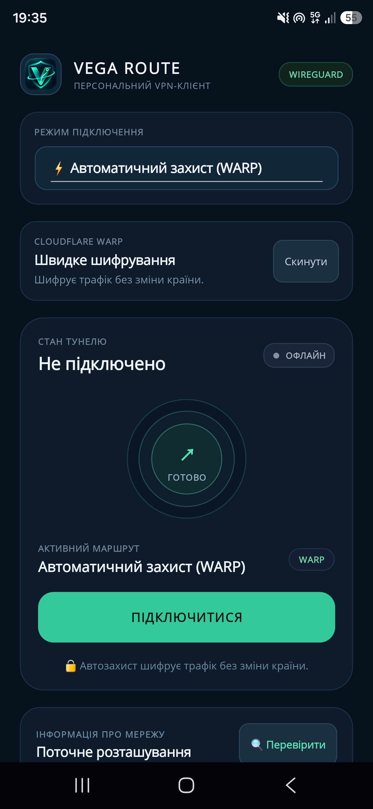
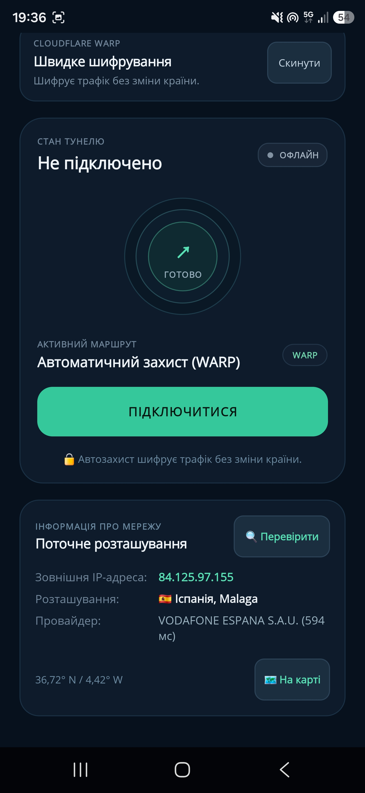

<strong>📸 VIEW SCREENSHOTS (6) — CLICK TO OPEN</strong>

<h3>🌐 Vega Route — Android Screenshots</h3>

<strong>🏠 Main Screen</strong>

<strong>🗺️ IP Geolocation Map</strong>

<strong>📡 Network Information</strong>

<strong>🛡️ Vega Route VPN</strong>

<strong>📂 WireGuard Configuration Import</strong>

<strong>🌍 Country Selection</strong>

# 🌐 Vega Route

### Secure VPN • Dedicated Infrastructure • Automatic Protection • Interactive Maps

**Vega Route** is an Android VPN and network location application that combines dedicated VPN infrastructure, automatic Cloudflare WARP protection, universal WireGuard configuration support, IP geolocation, and interactive maps within a single interface.

Protect your internet connection, connect through dedicated or external VPN servers, manage WireGuard configurations, and explore your network's geographic location.

---

## ✨ Features

### 🛡️ Vega Route VPN

- Dedicated, self-managed VPN infrastructure.
- VPN server located in Frankfurt, Germany.
- Secure WireGuard connectivity.
- Automatic device registration without manual enrollment tokens.
- Administrator-controlled approval for new devices.
- Automatic generation and management of device identity and VPN keys.
- Automatic retrieval of VPN connection parameters.
- One-click connection and disconnection for authorized devices.
- Dynamic VPN server availability monitoring.
- Real-time tunnel status and connection verification.
- Secure device management and access revocation.

### ⚡ Automatic Protection — Cloudflare WARP

- Automatic internet traffic encryption through Cloudflare WARP.
- Secure connectivity without intentionally selecting a different country.
- Automatic registration and configuration management.
- Automatic validation of stored VPN configurations.
- Intelligent recovery when local VPN configuration becomes invalid or corrupted.
- Protection against unnecessary key resets during temporary network failures.
- Limited automatic recovery attempts.
- Contextual recovery notifications.
- Manual key reset available only when recovery requires user intervention.
- Minimalist interface during normal operation.

### 🌍 WireGuard Configuration Import

- Import standard WireGuard `.conf` configuration files.
- Connect to compatible external VPN providers.
- Connect to personal and self-hosted WireGuard servers.
- Manage imported VPN connection profiles.
- Select available countries and connection configurations.
- Switch between imported VPN profiles.
- Verify your public IP address and network location after connecting.

### 🔐 Secure VPN Connection

- Encrypted network traffic through WireGuard VPN tunnels.
- VPN connection and disconnection management.
- Real-time connection status monitoring.
- Active connection verification.
- Secure VPN configuration management.
- Automatic device identity management.
- Secure storage of private keys and connection credentials.
- Connection recovery and diagnostic logging.
- Protection against unnecessary configuration resets.

### 🗺️ Interactive Maps

- Integrated interactive geographic map.
- Display your current network location.
- Explore geographic locations directly on the map.
- Visualize location information associated with your public IP address.
- Verify your network location after establishing a VPN connection.
- Convenient navigation between network information and geographic maps.

### 📡 IP & Network Information

- Public IP address detection.
- IPv4 and IPv6 address information.
- IP-based geographic location.
- Country and city information.
- Internet service provider information.
- Network latency information.
- Geographic coordinates associated with the detected IP address.
- Network location verification.
- VPN connection status and diagnostics.
- Direct access to the detected location on the interactive map.

### 🎨 User Interface

- Modern, mobile-friendly Android interface.
- Consistent connection mode selector with dedicated icons.
- Compact VPN server information card.
- Dynamic server availability indicators.
- Real-time tunnel status visualization.
- Animated connection state indicators.
- Convenient one-click VPN connection controls.
- Clear active route descriptions.
- Contextual connection recovery notifications.
- Integrated map navigation.
- Detailed network and location information.
- Automatic interface adaptation to the selected connection mode.
- Minimal unnecessary technical information during normal operation.

### 🌍 Automatic Language Detection & Localization

- Supports 18 application languages.
- Automatically detects the device's system language.
- Adapts the application interface to the detected language when a corresponding localization is available.
- Provides automatic fallback to the default language when necessary.
- Localized connection states, server information, recovery notifications, and diagnostic messages.
- No manual language configuration required.

---

## 🔒 Privacy & Security

Vega Route uses WireGuard VPN technology to encrypt network traffic routed through the VPN tunnel.

The dedicated Vega Route VPN service implements cryptographic device authentication and administrator-controlled access management.

### Device Authentication

- ECDSA NIST P-256 device identity.
- Cryptographic Proof-of-Possession verification during device registration.
- Digitally signed API requests.
- SHA-256 request body hashing.
- Timestamp validation.
- Nonce-based replay attack protection.
- Strict public key validation.
- Protection against unauthorized replacement of registered device identities.
- Secure device identity storage using Android Keystore.

### VPN Access Management

- Automatic device registration.
- Administrator-controlled approval of new devices.
- Mandatory SHA-256 public key fingerprint verification.
- Registration expiration and pending registration limits.
- VPN access restricted to approved devices.
- Automated WireGuard peer provisioning.
- Device access rejection and revocation.
- Reliable removal of revoked WireGuard peers.

### Infrastructure Security

- Publicly trusted HTTPS certificates.
- Restricted administrative API access.
- VPN client isolation.
- Private network access restrictions.
- Dedicated DNS resolution.
- Persistent configuration management.
- Verified database backups.
- Transactional database migrations.
- Deployment verification gates.
- Automatic deployment rollback.
- Automatic certificate renewal mechanism.

VPN server selection can change the public IP address and geographic location associated with your internet connection.

**Note:** IP-based geolocation is approximate and does not necessarily represent the device's physical GPS location.

---

## 🖥️ Dedicated VPN Infrastructure

Vega Route operates its own dedicated VPN infrastructure in Frankfurt, Germany.

The server infrastructure includes:

- Linux ARM64 production environment.
- WireGuard VPN gateway.
- ASP.NET Core 10 device management and VPN orchestration API.
- SQLite persistent database.
- Nginx HTTPS reverse proxy.
- Let's Encrypt certificate management.
- Unbound DNS resolver.
- IPv4 forwarding and network address translation.
- VPN client isolation and network access restrictions.
- Automated device and WireGuard peer management.
- API health and readiness monitoring.
- Automatic service startup and infrastructure recovery after server reboot.
- Verified production backups and automatic deployment rollback.

---

## 📱 Platform & System Requirements

| Specification | Details |
|---|---|
| Platform | Android |
| Minimum Android Version | Android 7.0 (API 24) |
| Target Android Version | Android 16 (API 36) |
| Supported Architectures | ARM64 (`arm64-v8a`), x86_64 |
| Runtime | .NET 10 |
| Distribution | Universal APK |
| Application ID | `com.vegaroute.mobile` |
| Supported Languages | 18 |
| Current Version | 1.2.0 |

---

## 📦 Installation

1. Open the [Releases](https://github.com/Roman-git-hub/VegaRoute/releases) page.
2. Download the latest signed Android Universal APK.
3. Install the APK on your Android device.
4. Launch Vega Route.
5. Select your preferred connection mode.
6. Grant Android VPN permissions when requested.
7. Connect to your selected VPN service.

### Vega Route VPN

Select **🛡️ Vega Route VPN** and press the connection button.

New devices are automatically registered and require administrator approval before VPN access is granted.

Previously approved devices can connect without repeating the registration process.

### Cloudflare WARP

Select **⚡ Automatic Protection (WARP)** and press the connection button.

The application automatically manages the required registration, VPN configuration, and connection credentials.

### WireGuard Configuration Import

Select **🌍 WireGuard Configuration Import**, import a valid WireGuard `.conf` file, select the desired configuration, and connect.

---

## 🔄 Automatic Updates

Official application updates are distributed through GitHub Releases.

- Digitally signed Android release packages.
- Compatibility with the existing Vega Route release signing certificate.
- Application version management.
- Support for updating existing installations without deleting application data.
- Preservation of existing application settings, device registrations, and stored VPN configurations.
- SHA-256 integrity verification for release packages.

Existing users can install an official compatible update directly over their current installation.

---

## 🧪 Testing & Reliability

Vega Route v1.2.0 has undergone extensive client-side, server-side, and production infrastructure testing.

- 70/70 server tests passed.
- 38/38 client tests passed.
- Cryptographic device registration and authentication tests.
- Replay attack protection tests.
- Device approval and fingerprint validation tests.
- WireGuard peer creation and removal tests.
- Database migration regression tests.
- WARP recovery and concurrency tests.
- Production API lifecycle verification.
- Production HTTPS connectivity verification.
- Certificate renewal simulation.
- Production backup and rollback verification.
- Full production server reboot verification.
- Successful infrastructure recovery after reboot.
- Physical device testing on Samsung Galaxy S24 Ultra.
- Verified installation of the signed Universal APK over an existing installation.

---

## 🛠️ Technology

### Android Client

- .NET 10
- .NET MAUI
- C#
- Android VPN Service
- WireGuard
- Cloudflare WARP
- Android Keystore
- Secure application storage
- ECDSA P-256 cryptographic authentication
- SHA-256 integrity verification
- IP geolocation services
- Interactive map integration

### Server Infrastructure

- Linux ARM64
- ASP.NET Core 10
- WireGuard VPN
- SQLite WAL
- Nginx
- Let's Encrypt
- Unbound DNS
- Netfilter / nftables
- Systemd
- Automated deployment, backup, and rollback mechanisms

---

## 📥 Downloads

Official application releases are available here:

**[Download Vega Route — Latest Release](https://github.com/Roman-git-hub/VegaRoute/releases/latest)**

All official APK releases are digitally signed.

Use the SHA-256 checksum provided with each release to verify the integrity of the downloaded APK.

---

## 📄 License

Vega Route is distributed as freeware under a proprietary license.

You may download, install, and use official releases free of charge.

Copyright © 2026 Roman-git-hub. All rights reserved.

See [LICENSE](LICENSE) for full terms.

Third-party components remain subject to their respective licenses.

---

**Vega Route — Secure your connection. Protect your privacy. Explore your network location.**
